

  
  
  
  
  

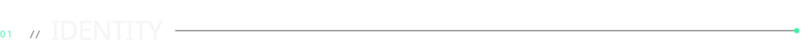

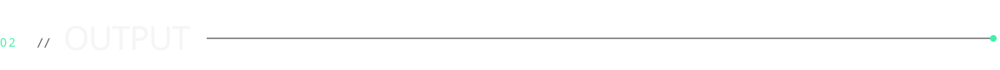

&nbsp;Measured on systems I built as an AI/ML & Data Science Intern at SAVIC Technologies (June – July 2026).


  <a href="https://github.com/avkad3/CodeAtlas"></a>
  <a href="https://github.com/avkad3/Google_Maps_Competitor_Update_Intelligence"></a>
  <a href="https://github.com/avkad3/CMPIS-Construction-Material-Price-Intelligence-System"></a>
  <a href="https://github.com/avkad3/ASCII-Lab"></a>
  <a href="https://github.com/avkad3/mini-order-fulfillment-system"></a>
  <a href="https://github.com/avkad3/loan-eligibility-prediction"></a>
  <a href="https://github.com/avkad3/RCAE-Reservation-Conflict-Anticipation-Engine"></a>
  <a href="https://github.com/avkad3/Waste-Image-Classifier"></a>

  Live: <a href="https://ascii-lab.onrender.com/">ASCII Lab</a> · <a href="https://loan-eligibility-prediction-dfpa88fchykapafeu7keqc.streamlit.app/">Loan Eligibility</a> &nbsp;|&nbsp;
  Case studies: <a href="https://my-portfolio-nine-pied-83.vercel.app/#work">my-portfolio-nine-pied-83.vercel.app</a> &nbsp;|&nbsp;
  Also: <b>BuildVault-AI</b>, business management for builders, in production use by a customer (private)

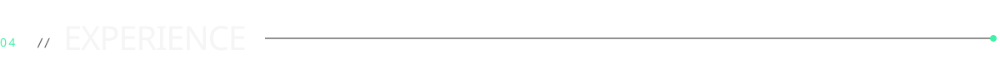

| | |
|---|---|
| **SAVIC Technologies** · AI/ML & Data Science Intern Jun – Jul 2026 | Demand forecasting across 34,000+ series (−22% stock-outs) · RAG QA agent for GR-IR reconciliation (94% semantic accuracy) · reservation platform + RCAE (−30% overbooking) |
| **Suraj Homes** · Project Management Intern Dec 2025 – Jan 2026 | Residential project timelines, contractor and vendor coordination, construction and quality-control workflows |
| **Globe Infra Developers** · Business Operations Intern Jun – Jul 2025 | Operations data and reporting in Excel, coordination with external stakeholders |

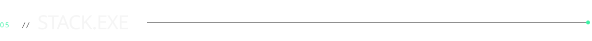

   
  

<b>LLM / GenAI</b> LangChain · LangGraph · RAG · ChromaDB · FAISS · Azure OpenAI · Hugging Face · Ollama · MCP 
<b>ML / Data</b> PyTorch Forecasting (TFT) · LightGBM · Stable Baselines3 · Gymnasium · Pandas · NumPy · NetworkX · Plotly · Streamlit

  

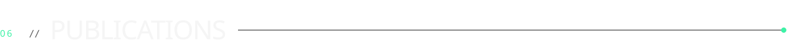

- **Reservation Conflict Anticipation Engine (RCAE)** — Zenodo (CERN), [doi:10.5281/zenodo.21477811](https://doi.org/10.5281/zenodo.21477811)
- **pycodeatlas** — [PyPI](https://pypi.org/project/pycodeatlas/) · `pip install pycodeatlas`
- Certifications: Google DeepMind AI Research Foundations · NLP on Google Cloud · Transformer Models and BERT · Anthropic AI Fluency Framework & Foundations

<a href="mailto:avkad3@gmail.com">
  
</a>

<!-- Visuals are generated by scripts/build_assets.py — edit the data there and re-run. -->
