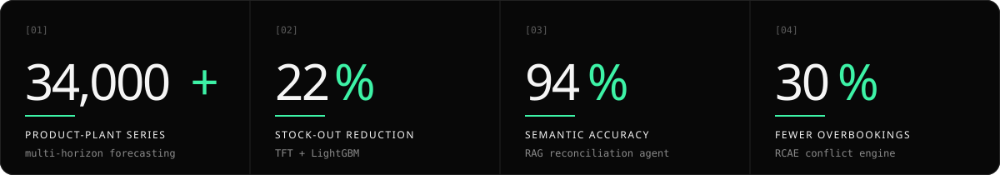

<a href="https://my-portfolio-nine-pied-83.vercel.app">
  
</a>

<p align="center">
  <a href="https://my-portfolio-nine-pied-83.vercel.app"></a>
  <a href="https://www.linkedin.com/in/aditya-vijay-kumar-6a83b7370"></a>
  <a href="mailto:avkad3@gmail.com"></a>
  <a href="https://pypi.org/project/pycodeatlas/"></a>
  <a href="https://doi.org/10.5281/zenodo.21477811"></a>
</p>

```yaml
whoami:      Aditya Vijay Kumar — AI/ML and backend engineering student, Mumbai
ships:       Python and Go systems — LLM and RAG pipelines, forecasting,
             static analysis tooling and real-time web apps
education:   B.E. Computer Engineering (AI & ML), Pillai College of Engineering, Panvel — 2023–2027
published:   pycodeatlas on PyPI · RCAE algorithm on Zenodo (CERN)
portfolio:   https://my-portfolio-nine-pied-83.vercel.app   # press Ctrl/⌘ K, try `sudo hire aditya`
```

### `> impact`



<sub>Measured on systems I built as an AI/ML & Data Science Intern at SAVIC Technologies (June – July 2026).</sub>

### `> systems --built`

<table>
<tr>
<td width="50%" valign="top">

**[PyCodeAtlas](https://github.com/avkad3/CodeAtlas)** · published on PyPI<br/>
Static analysis CLI that maps a codebase's dependency graph, classifies dead code as unused, test-only or uncovered, and shows what breaks if you delete a function or module. Runtime tracing via `sys.settrace`; understands Django, Flask and FastAPI routes.<br/>
<sub>`Python` `AST` `NetworkX` `D3.js` `SQLite` `Click`</sub><br/>
<sub>[case study](https://my-portfolio-nine-pied-83.vercel.app/projects/pycodeatlas) · [pypi](https://pypi.org/project/pycodeatlas/) · `pip install pycodeatlas`</sub>

</td>
<td width="50%" valign="top">

**[Google Maps Competitor Update Intelligence](https://github.com/avkad3/Google_Maps_Competitor_Update_Intelligence)**<br/>
Scrapes competitors' Google Maps updates with Selenium, de-duplicates them by fingerprint, classifies them with LLMs (four providers + offline fallback), charts topic trends and drafts new posts.<br/>
<sub>`Python` `Flask` `Selenium` `SQLite` `Gemini` `Groq` `Docker`</sub><br/>
<sub>[case study](https://my-portfolio-nine-pied-83.vercel.app/projects/maps-competitor-intelligence)</sub>

</td>
</tr>
<tr>
<td width="50%" valign="top">

**[CMPIS — Construction Material Price Intelligence](https://github.com/avkad3/CMPIS-Construction-Material-Price-Intelligence-System)**<br/>
Compares vendor quotes against six months of price history and flags each item green, yellow or red. Parses purchase orders and fuzzy-matches line items to the catalog.<br/>
<sub>`FastAPI` `Streamlit` `SQLAlchemy` `RapidFuzz` `Plotly`</sub><br/>
<sub>[case study](https://my-portfolio-nine-pied-83.vercel.app/projects/cmpis)</sub>

</td>
<td width="50%" valign="top">

**[ASCII Lab](https://github.com/avkad3/ASCII-Lab)** · live<br/>
Images, video and live webcam rendered as ASCII with 5 rendering modes, Floyd-Steinberg / Atkinson / ordered dithering and per-character colour. Dockerised, tested with pytest.<br/>
<sub>`FastAPI` `OpenCV` `NumPy` `Pillow` `pytest` `Docker`</sub><br/>
<sub>[live demo](https://ascii-lab.onrender.com/) · [case study](https://my-portfolio-nine-pied-83.vercel.app/projects/ascii-lab)</sub>

</td>
</tr>
<tr>
<td width="50%" valign="top">

**[Mini Order Fulfillment System](https://github.com/avkad3/mini-order-fulfillment-system)**<br/>
SAP Order-to-Cash in miniature: customers upload POs (Excel/PDF), suppliers approve, reject or partially approve, and approved orders become sales orders that reserve inventory. Role-based JWT auth.<br/>
<sub>`React` `TypeScript` `FastAPI` `SQLAlchemy` `Alembic` `JWT`</sub><br/>
<sub>[case study](https://my-portfolio-nine-pied-83.vercel.app/projects/mini-order-fulfillment)</sub>

</td>
<td width="50%" valign="top">

**[Loan Eligibility Prediction](https://github.com/avkad3/loan-eligibility-prediction)** · live<br/>
MLOps around a Random Forest: MLflow tracking, DVC data versioning, SHAP + LIME explanations, a Fairlearn audit, a FastAPI service and CI on every push.<br/>
<sub>`scikit-learn` `MLflow` `DVC` `SHAP` `FastAPI` `Streamlit`</sub><br/>
<sub>[live app](https://loan-eligibility-prediction-dfpa88fchykapafeu7keqc.streamlit.app/) · [case study](https://my-portfolio-nine-pied-83.vercel.app/projects/loan-eligibility)</sub>

</td>
</tr>
<tr>
<td width="50%" valign="top">

**[RCAE — Reservation Conflict Anticipation Engine](https://github.com/avkad3/RCAE-Reservation-Conflict-Anticipation-Engine)** · published on Zenodo<br/>
Scores a booking on turnover clustering, cascade risk, kitchen load and dead time — the engine behind a reservation platform that cut overbooking incidents by 30%.<br/>
<sub>`Python` `FastAPI` `React` `SQLite`</sub><br/>
<sub>[DOI](https://doi.org/10.5281/zenodo.21477811) · [case study](https://my-portfolio-nine-pied-83.vercel.app/projects/rcae-reservations)</sub>

</td>
<td width="50%" valign="top">

**[Waste Image Classifier](https://github.com/avkad3/Waste-Image-Classifier)**<br/>
Sorts waste photos into six material classes — a custom CNN baseline, then MobileNetV2 transfer learning — served in a Streamlit app.<br/>
<sub>`TensorFlow` `MobileNetV2` `scikit-learn` `Streamlit`</sub><br/>
<sub>[case study](https://my-portfolio-nine-pied-83.vercel.app/projects/waste-classifier)</sub>

</td>
</tr>
</table>

<sub>Also: **BuildVault-AI** — business management system for builders and construction firms, in production use by a customer (private repository).</sub>

### `> experience`

| | |
|---|---|
| **SAVIC Technologies** · AI/ML & Data Science Intern<br/><sub>Jun – Jul 2026</sub> | Demand forecasting across 34,000+ series (−22% stock-outs) · RAG QA agent for GR-IR reconciliation (94% semantic accuracy) · reservation platform + RCAE (−30% overbooking) |
| **Suraj Homes** · Project Management Intern<br/><sub>Dec 2025 – Jan 2026</sub> | Residential project timelines, contractor and vendor coordination, construction and quality-control workflows |
| **Globe Infra Developers** · Business Operations Intern<br/><sub>Jun – Jul 2025</sub> | Operations data and reporting in Excel, coordination with external stakeholders |

### `> stack`

<p>
  <br/>
  <br/>
  
</p>

<sub>**LLM / GenAI** — LangChain · LangGraph · RAG · ChromaDB · FAISS · Azure OpenAI · Hugging Face · Ollama · MCP · prompt engineering<br/>
**ML / Data** — PyTorch Forecasting (TFT) · LightGBM · Stable Baselines3 · Gymnasium · Pandas · NumPy · NetworkX · Plotly · Streamlit<br/>
**Backend** — REST APIs · WebSockets · SQLAlchemy · **Tools** — pytest · CI/CD · Render</sub>

### `> publications && certifications`

- **Reservation Conflict Anticipation Engine (RCAE)** — Zenodo (CERN), [doi:10.5281/zenodo.21477811](https://doi.org/10.5281/zenodo.21477811)
- **pycodeatlas** — [PyPI](https://pypi.org/project/pycodeatlas/)
- Google DeepMind AI Research Foundations · NLP on Google Cloud · Transformer Models and BERT · Anthropic AI Fluency Framework & Foundations

### `> languages`


---

```console
$ sudo hire aditya
✓ Request accepted. Opening contact channel... → avkad3@gmail.com
```
